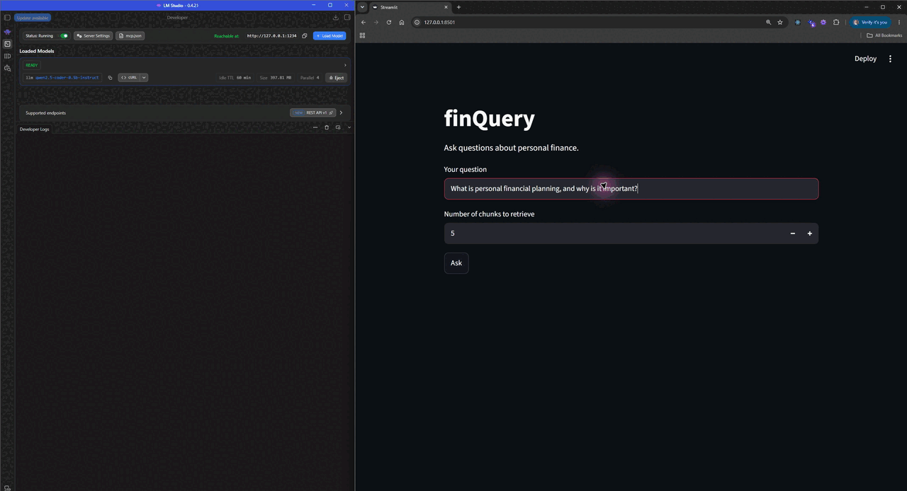

# finQuery

finQuery is a practice exercise for learning how retrieval-augmented generation (RAG) works, created alongside Codecademy's [Retrieval-Augmented Generation for AI Applications](https://www.codecademy.com/enrolled/courses/retrieval-augmented-generation-for-ai-applications) course. It uses selected chapters from Saylor Academy's [Personal Finance textbook](https://resources.saylor.org/wwwresources/archived/site/textbooks/Personal%20Finance.pdf) as its reference data and lets you compare four RAG approaches in a Streamlit app.

## Demo



## Tech stack

- **Python 3.13** — application logic
- **Streamlit** — web interface
- **ChromaDB** — vector storage and search
- **LangChain Text Splitters** — document chunking
- **LM Studio** — local model serving
- **PyMuPDF** — PDF text extraction
- **OpenAI Python SDK** — model API requests

## Project structure

```text
.
├── .env.example                 # LM Studio environment variable template
├── .gitignore
├── .python-version              # Required Python version (3.13)
├── Pipfile                      # Python dependencies and Pipenv scripts
├── Pipfile.lock
├── README.md
├── demo.gif
├── app.py                       # Streamlit interface and four RAG tabs
├── chunk.py                     # Splits prepared Markdown into searchable chunks
├── ingest.py                    # Creates or updates the local ChromaDB collection
├── prepare.py                   # Downloads and formats selected textbook chapters
└── rag/
    ├── __init__.py              # Public RAG pipeline entry points
    ├── baseline.py              # Standard retrieve-then-answer flow
    ├── common.py                # Shared retrieval, prompts, and LM Studio client
    ├── contextual_rewriting.py  # Rewrites follow-up questions using chat history
    ├── hyde.py                  # Hypothetical Document Embeddings flow
    └── multi_query.py           # Alternative queries and Reciprocal Rank Fusion
```

## Setup and usage

Requires Python 3.13, [Pipenv](https://pipenv.pypa.io/en/latest/), and [LM Studio](https://lmstudio.ai/) with a chat model loaded and its local server running. Set `LM_STUDIO_BASE_URL`, `LM_STUDIO_MODEL`, and `LM_STUDIO_API_KEY` in your environment, then run:

```bash
pip install pipenv
pipenv install
pipenv run python ingest.py
pipenv run start
```

Ingestion fetches the textbook PDF into memory, extracts the selected chapters, and builds the local vector database. Open the Streamlit URL, choose a RAG tab, and ask a question.
